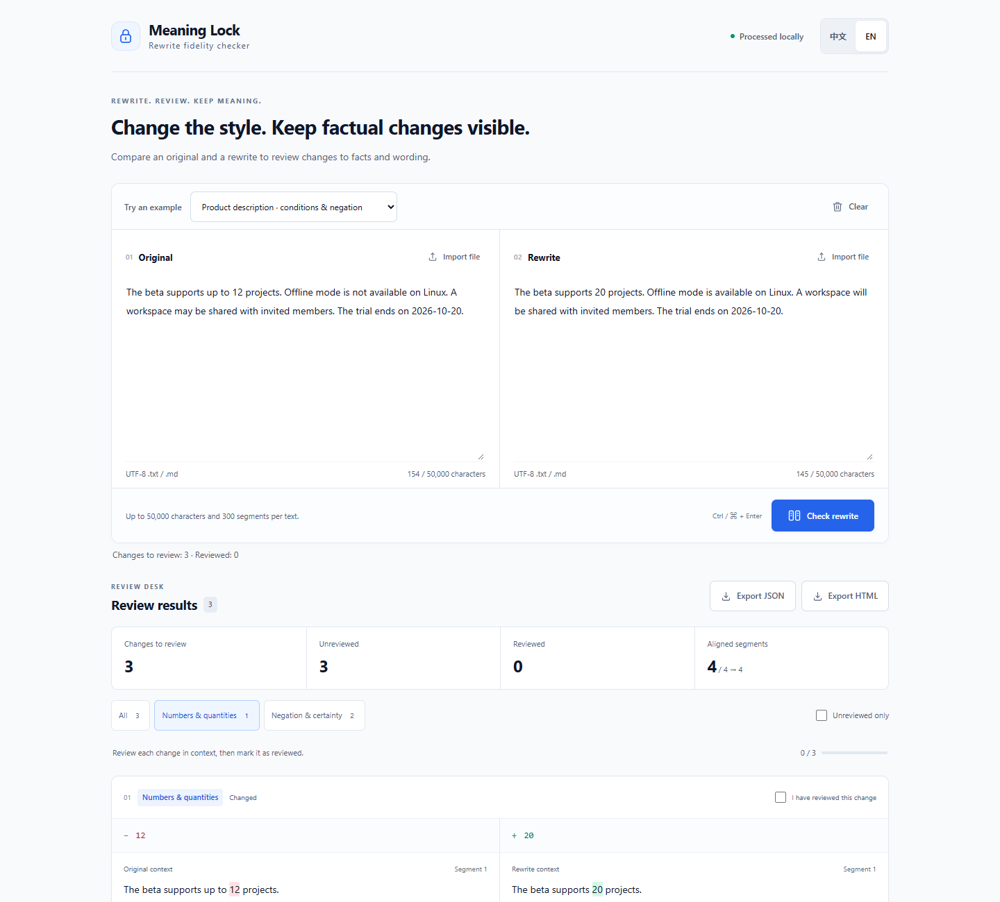

# Meaning Lock

[中文说明](README_ZH.md) · [Method](docs/method.md) · [MIT license](LICENSE)

**Review factual changes before you accept a rewrite.**

Meaning Lock compares an original with an edited version and brings changes to numbers, dates, certainty, links and code into one review desk. Text is checked locally in your browser, with a Chinese / English interface and exportable reports.

**中文简介：** 本地运行的改写保真校对器，逐项复核数字、日期、限定词、链接与代码的变化，支持中英文界面和 HTML / JSON 报告。



## A small edit with a large consequence

| Original | Rewrite | Review |
|---|---|---|
| Revenue was **about 2.3 billion**. | Revenue was **23 billion**. | Magnitude and approximation changed. |
| The service **may** recover. | The service **will** recover. | Certainty changed. |
| Send to `/v1/events` with `timeout: 30`. | Send to `/v2/events` with `timeout: 300`. | Code changed. |

The built-in examples cover a Chinese financial summary, an English product description, a technical document, and equivalent units with reordered sentences.

## Start locally

Use **Node.js 24 or newer** and npm.

```bash
git clone https://github.com/cloudwallker/meaning-lock.git
cd meaning-lock
npm ci
npm run dev
```

Open the local URL printed by Vite. Choose an example or paste both texts, select **Check rewrite**, then review changes in context. Mark each reviewed item and export a JSON or standalone HTML report. `Ctrl / Cmd + Enter` also starts a check. Changing either input clears the previous report and review marks.

To serve the production build:

```bash
npm run build
npm run preview
```

The built site is in `dist/site`; the shared engine is in `dist/core.js`. Browser checks run in a Web Worker. Once the local server and page are loaded, checking text does not require an internet connection. Text is not saved automatically; refreshing clears the current workspace. Exported reports contain both texts, so store and share them according to their contents.

## What you can review

- Numbers and common quantity units, including Chinese 万 / 亿 and English thousand / million / billion; common equivalent quantities are normalized.
- Dates, negation, certainty and approximation terms.
- Markdown links, reference links, bare URLs, inline and fenced code.
- Added or removed segments, changes to fact-bearing wording, and ambiguous alignment, including reordered sentences.
- Category filters, individual review marks, context and segment positions.

Inputs accept UTF-8 `.txt` / `.md` files up to 200 KB. Each text may contain up to 50,000 UTF-16 code units and 300 segments. Rules and segment alignment determine coverage. **Zero findings means these rules found no differences.** See [the method and examples](docs/method.md) for interpretation and supported expressions.

## Command line

Build once, then reuse the same checker on files:

```bash
npm run build
node bin/meaning-lock.mjs examples/cli/original.md examples/cli/revised.md
node bin/meaning-lock.mjs examples/cli/original.md examples/cli/revised.md --format html --lang zh --output review.html
node bin/meaning-lock.mjs examples/cli/original.md examples/cli/revised.md --fail-on-change --output review.json
```

Default output is JSON to stdout. `--format` accepts `json` or `html`; `--lang` sets the HTML language. Exit codes are `0` for a completed check, `1` for findings when `--fail-on-change` is enabled, and `2` for invalid arguments or a failed check. `--help` prints usage without requiring a build.

## Development

```bash
npm test
npm run build
npx playwright install chromium
npm run test:e2e
```

Vitest checks the rules, report exports, worker boundary and CLI. Playwright exercises imports, review and export, input invalidation, language switching, escaped HTML, local requests, and 375 / 768 / 1440 px layouts. The GitHub Actions workflow runs the same commands on Node 24.

The core lives in `src/core`, the workbench in `src/App.tsx`, and the CLI in `bin/meaning-lock.mjs`. To contribute a rule, include a small original / rewrite pair and its expected findings. Use synthetic or public text in examples and issue reports.

## License and inspiration

MIT © 2026 [cloudwallker](https://github.com/cloudwallker). The editing workflows of [Humanizer](https://github.com/blader/humanizer) and [Humanizer-zh](https://github.com/op7418/Humanizer-zh) inspired the use case. The checker and application are implemented independently.
