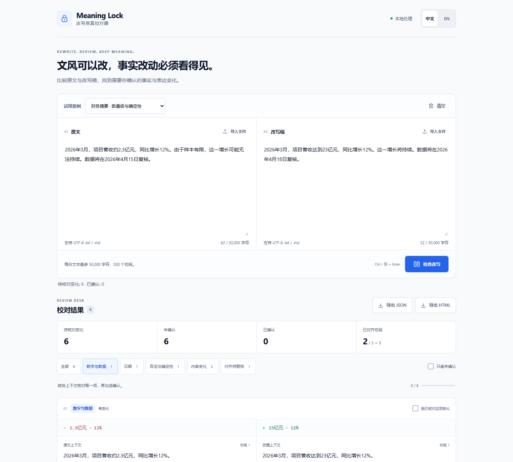

# Meaning Lock 改写保真校对器

[English](README.md) · [检查方法](docs/method.md) · [MIT 许可证](LICENSE)

**文风可以改，事实改动必须看得见。**

Meaning Lock 对比原文与改写稿，将数字、日期、限定词、链接和代码的变化汇集到一个校对工作台。核对数字时，工具会区分百分比与百分点。文本在浏览器本地检查，提供中英文界面和可导出的审阅报告。

**English summary:** A local rewrite fidelity checker for reviewing changes to numbers, dates, qualifiers, links and code, with a bilingual interface and HTML / JSON reports.



## 看见润色中的事实变化

| 原文 | 改写稿 | 需要复核 |
|---|---|---|
| 营收**约 2.3 亿元**。 | 营收达到 **23 亿元**。 | 数量级与近似程度改变。 |
| 利润率提高 **2%**。 | 利润率提高 **2 个百分点**。 | 增幅的单位改变。 |
| 增长**可能**持续。 | 增长**将**持续。 | 结论强度改变。 |
| 请求 `/v1/events`，设置 `timeout: 30`。 | 请求 `/v2/events`，设置 `timeout: 300`。 | 代码改变。 |

内置四组案例：中文财务摘要、英文产品说明、技术文档、等值单位与句段重排。

## 本地运行

准备 **Node.js 24 或更新版本**和 npm。

```bash
git clone https://github.com/cloudwallker/meaning-lock.git
cd meaning-lock
npm ci
npm run dev
```

打开 Vite 输出的本地地址。选择案例或粘贴两份文本，点击「检查改写」，结合上下文逐项确认，随后导出 JSON 或可独立打开的 HTML 报告。`Ctrl / Cmd + Enter` 也可开始检查。修改任一输入后，之前的报告和确认状态会清除。

使用生产构建：

```bash
npm run build
npm run preview
```

网页输出到 `dist/site`，共享引擎输出到 `dist/core.js`。网页使用 Web Worker 运行检查。本地服务和页面加载完成后，检查文本无需互联网连接。输入不会自动保存，刷新页面会清空当前工作区。导出报告含两份完整文本，请按文本内容决定保存和分享方式。

## 支持的复核项目

- 数字与常用数量单位，包含万、亿及 thousand / million / billion；常见等值表达会归一化。
- 支持中英文完整写法的百分点和基点，例如 `25 个基点` 与 `0.25 个百分点` 等价。核对金融稿件时请写全单位。`bps` 等缩写也可能表示网络速率，工具会保留原文供复核。
- 日期、否定、确定性和近似限定词。
- Markdown 链接、引用式链接、裸 URL、行内代码与围栏代码。
- 句段新增、删除、事实所在句段的文字变化、重排和模糊对齐。
- 分类筛选、逐项确认、上下文与句段位置。

导入支持不超过 200 KB 的 UTF-8 `.txt` / `.md` 文件。每侧上限 50,000 个 UTF-16 代码单元、300 个句段。规则覆盖范围与句段对齐会影响结果。**零条命中表示这些规则没有发现差异。** 表达支持范围与解释见[检查方法](docs/method.md)。

## 命令行检查

构建后可在文件上复用同一检查引擎：

```bash
npm run build
node bin/meaning-lock.mjs examples/cli/original.md examples/cli/revised.md
node bin/meaning-lock.mjs examples/cli/original.md examples/cli/revised.md --format html --lang zh --output review.html
node bin/meaning-lock.mjs examples/cli/original.md examples/cli/revised.md --fail-on-change --output review.json
```

默认将 JSON 写入标准输出。`--format` 支持 `json` 与 `html`，`--lang` 指定 HTML 语言。完成检查退出码为 `0`；启用 `--fail-on-change` 且发现变化时为 `1`；参数错误或检查失败时为 `2`。`--help` 可在构建前查看帮助。

## 开发与验证

```bash
npm test
npm run build
npx playwright install chromium
npm run test:e2e
```

Vitest 覆盖检查规则、报告导出、Worker 边界和 CLI。Playwright 覆盖导入、核对与导出、输入变化失效、双语切换、HTML 转义、本地请求以及 375 / 768 / 1440 像素布局。GitHub Actions 在 Node 24 上执行相同命令。

规则位于 `src/core`，工作台位于 `src/App.tsx`，CLI 位于 `bin/meaning-lock.mjs`。贡献规则时，提供一组原文与改稿及预期结果；案例和问题反馈使用合成或公开文本。

## 许可证与需求参考

MIT © 2026 [cloudwallker](https://github.com/cloudwallker)。需求场景参考了 [Humanizer](https://github.com/blader/humanizer) 和 [Humanizer-zh](https://github.com/op7418/Humanizer-zh) 的编辑流程。检查引擎与应用代码独立实现。
